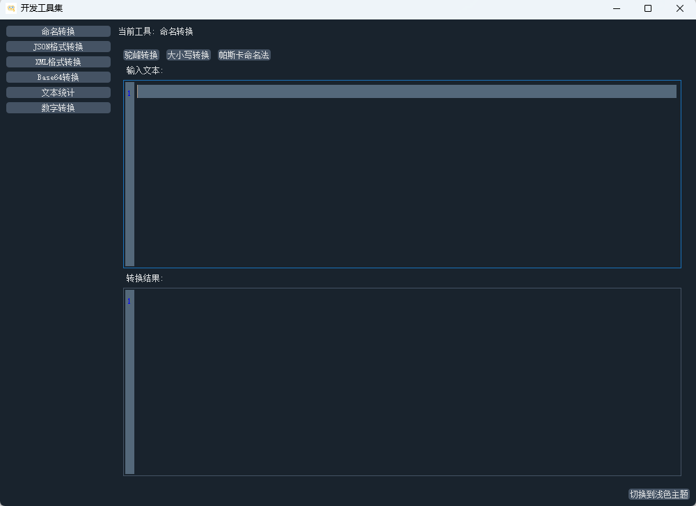
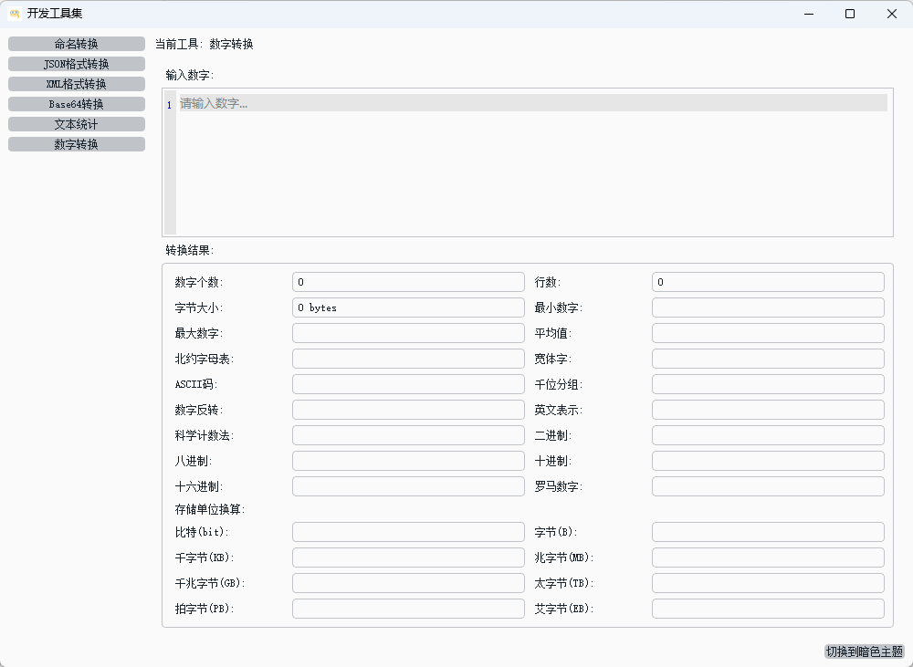

# DevUtilsApp - 开发者工具集合

一个轻量级、功能丰富的开发者实用工具集合，旨在简化开发过程中的常见数据处理、格式化与转换任务。

## 🚀 功能特性

### 数据格式化与验证
- **JSON格式化器**：美化、验证JSON数据，支持树形视图展示和错误定位
- **XML格式化器**：格式化XML内容，支持树形结构展示、XML与JSON互转

### 编码与转换
- **Base64编解码器**：在文本和Base64编码之间进行双向转换
- **命名格式转换器**：在驼峰式、下划线式、帕斯卡式等多种命名格式之间转换

### 文本处理
- **文本统计工具**：计算字符数、字数、汉字数、标点符号等统计信息

### 用户体验
- **主题切换**：支持深色/浅色主题，提供舒适的编码环境
- **带行号的文本编辑器**：便于查看和编辑代码内容
- **右键上下文菜单**：提供复制、粘贴、查找等常用操作

## 🛠️ 技术栈

- **编程语言**：Python 3.8+
- **GUI框架**：PyQt5 v5.15.7
- **主题支持**：qdarkstyle v3.2.3
- **图像处理**：Pillow v10.0.0+
- **打包工具**：PyInstaller v6.14.2+

## 📦 安装依赖

在开始使用前，请先安装必要的依赖包：

```bash
pip install -r requirements.txt
```

## ▶️ 运行项目

使用以下命令启动应用程序：

```bash
python start_app.py
```

该启动脚本会自动将`src`目录添加到Python路径并启动主程序，无需手动配置路径。

## 🎨 应用程序图标

图标文件位于项目的`assets`目录中：
- `assets/app_icon.ico`：应用程序图标文件
- `assets/app_icon.png`：应用程序图标(PNG格式)

## 🖼️ 软件预览

以下是DevUtilsApp的界面预览图：

### 命名转换工具界面


### 数字转换工具界面


## 📤 打包与分发

### 使用打包脚本（推荐）

项目提供了两个打包脚本，分别用于单文件和多文件模式的打包：

#### 单文件模式打包
执行以下命令生成单文件可执行程序和安装包：

```bash
python scripts/build_installer.py
```

此脚本将执行以下操作：
1. 使用PyInstaller将项目打包为单文件exe
2. 自动创建安装包（支持Inno Setup和NSIS两种工具）
3. 安装包输出到 `installer/DevUtilsApp_Setup.exe`

#### 多文件模式打包
执行以下命令生成多文件可执行程序和安装包：

```bash
python scripts/build_multi_file_installer.py
```

此脚本将执行以下操作：
1. 使用PyInstaller将项目打包为多文件目录形式
2. 自动创建Inno Setup安装包
3. 安装包输出到 `installer/DevUtilsApp_Setup.exe`


如果你需要自定义打包选项，可以直接使用PyInstaller命令：

#### 单文件模式
```bash
pyinstaller --noconfirm --onefile --windowed --hidden-import=qdarkstyle --hidden-import=qdarkstyle.dark.palette --hidden-import=qdarkstyle.light.palette --hidden-import=qdarkstyle.dark.stylesheet --hidden-import=qdarkstyle.light.stylesheet --hidden-import=qdarkstyle.utils --add-data "ui;ui" --add-data "tools;tools" --add-data "assets;assets" --icon "assets/app_icon.ico" src/main.py
```

#### 多文件模式
```bash
pyinstaller --noconfirm --windowed --hidden-import=qdarkstyle --hidden-import=qdarkstyle.dark.palette --hidden-import=qdarkstyle.light.palette --hidden-import=qdarkstyle.dark.stylesheet --hidden-import=qdarkstyle.light.stylesheet --hidden-import=qdarkstyle.utils --add-data "ui;ui" --add-data "tools;tools" --add-data "assets;assets" --icon "assets/app_icon.ico" --name main src/main.py
```

## 📁 目录结构

项目采用模块化设计，将UI界面、工具逻辑和资源文件分离，便于维护和扩展：

```
dev-util-app/
├── src/                        # 源代码目录
│   └── main.py                 # 程序主入口
├── start_app.py                # 应用启动脚本
├── requirements.txt            # 项目依赖文件
├── README.md                   # 项目说明文档
├── installer/                  # 安装包输出目录
├── assets/                     # 资源文件目录
│   ├── app_icon.ico            # 应用程序图标文件
│   └── app_icon.png            # 应用程序图标(PNG格式)
├── scripts/                    # 脚本工具目录
│   └── build_installer.py      # 打包安装脚本
├── ui/                         # UI界面模块
│   └── main_window.py          # 主窗口实现
└── tools/                      # 工具模块集合
    ├── base_tool.py            # 工具基类
    ├── json_formatter.py       # JSON格式化工具
    ├── xml_formatter.py        # XML格式化工具
    ├── base64_converter.py     # Base64转换工具
    ├── name_converter.py       # 命名转换工具
    ├── text_statistics.py      # 文本统计工具
    ├── line_number_text_edit.py # 带行号的文本编辑器
    ├── find_manager.py         # 查找管理器
    └── text_context_menu.py    # 文本上下文菜单
```

## 📖 使用指南

### 基本操作流程
1. 启动应用程序后，通过左侧导航栏选择需要的工具
2. 在工具界面的输入区域输入或粘贴相应内容
3. 点击工具按钮执行相应操作（格式化、转换、编码等）
4. 查看输出结果或错误提示
5. 使用右下角的主题切换按钮可在深色/浅色主题间切换

### 工具详细说明

#### JSON格式化器
- **功能**：美化JSON数据、验证JSON格式正确性
- **使用方式**：粘贴JSON文本，点击"格式化JSON"按钮
- **特性**：支持错误提示、树形结构展示

#### XML格式化器
- **功能**：格式化XML内容、XML与JSON互转
- **使用方式**：粘贴XML文本，点击"格式化XML"或"转为JSON"按钮
- **特性**：支持树形结构展示、全部展开/合并操作

#### Base64编解码器
- **功能**：将普通文本编码为Base64格式，或将Base64编码解码为文本
- **使用方式**：输入文本，点击"转为base64"或"解码"按钮

#### 命名格式转换器
- **功能**：在驼峰式、下划线式、帕斯卡式等多种命名格式之间转换
- **支持格式**：驼峰命名、下划线命名、帕斯卡命名等

#### 文本统计工具
- **功能**：对输入的文本进行详细统计
- **统计项**：总字符数、总字数、总汉字数、中文标点符号数量等

## ⚠️ 注意事项

- **单文件vs多文件打包**：单文件模式分发更简单，但启动速度较慢；多文件模式启动速度更快，但分发相对复杂
- **图标路径**：应用使用`assets`目录存放图标文件，不要将其移动到其他位置
- **日志文件**：日志输出将显示在控制台，便于排查问题
- **系统要求**：确保已安装Python 3.8或更高版本，以及项目所需的所有依赖

## 🤝 贡献指南

欢迎对项目进行改进和扩展！如果你有任何建议或发现了问题，请通过以下方式参与贡献：
1. Fork项目仓库
2. 创建新的分支
3. 提交你的修改
4. 创建Pull Request

## 📝 许可证

本项目采用MIT许可证 - 详见LICENSE文件

## 📧 联系我们

如有任何问题或建议，请随时联系项目维护者。

---

✨ DevUtilsApp - 让开发工作更高效、更便捷！ ✨